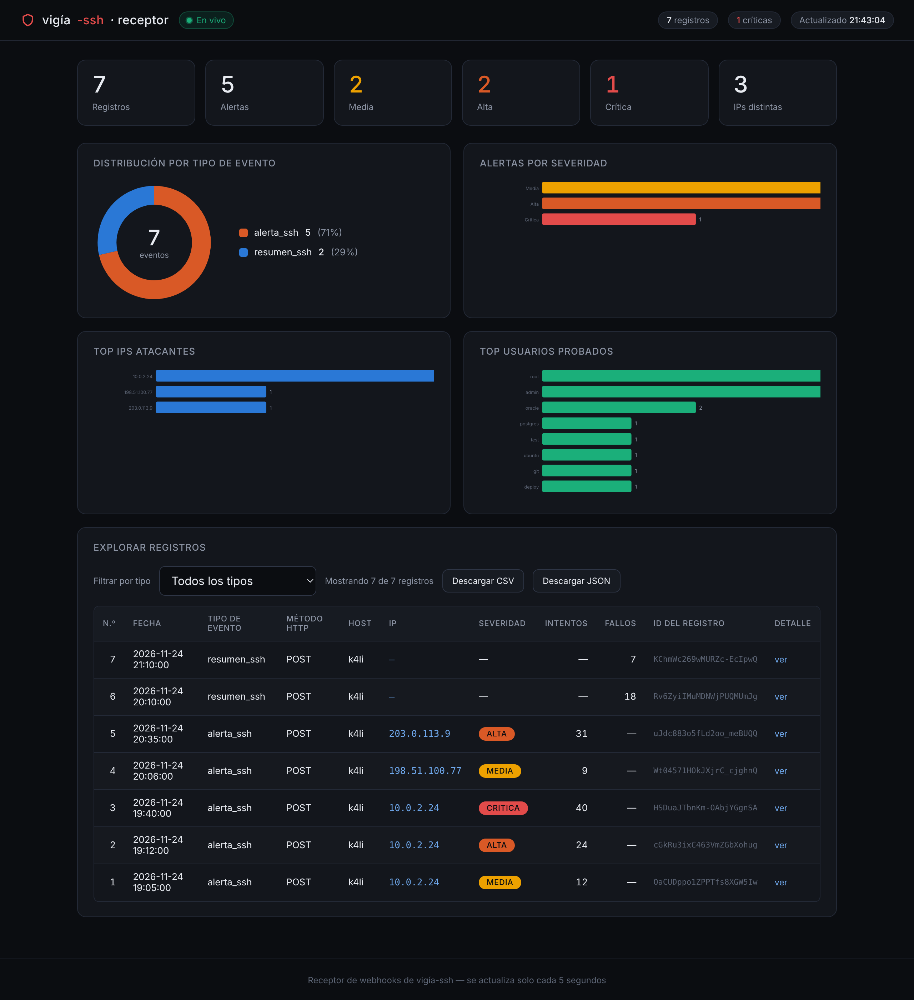

# vigia-ssh

[](https://github.com/mario98721/vigia-ssh/actions/workflows/tests.yml)
[](https://github.com/mario98721/vigia-ssh/actions/workflows/codeql.yml)


**Detector de fuerza bruta SSH para Linux, con alertas por webhook, bloqueo automático en nftables y un dashboard web en vivo.**

Lee los intentos de acceso de `sshd` en el journal de systemd, los agrupa por IP de origen dentro de
una ventana de tiempo, calcula la severidad y envía una alerta JSON a Discord o a cualquier webhook.
Si se lo pides, bloquea la IP atacante en nftables (IPv4 e IPv6) durante el tiempo que elijas.
Incluye un honeypot SSH que registra las contraseñas que prueban los atacantes, algo que `sshd` no
guarda, y un panel web que muestra las alertas en tiempo real.



> Proyecto de laboratorio y aprendizaje. Funciona en un servidor real, pero no pretende sustituir
> a fail2ban, a CrowdSec ni a un endurecimiento correcto de SSH (claves en vez de contraseñas).

## Índice

- [Dashboard](#dashboard)
- [Características](#características)
- [Instalación](#instalación)
- [Uso](#uso)
- [Configuración](#configuración)
- [Formato de las alertas](#formato-de-las-alertas)
- [Honeypot](#honeypot)
- [Seguridad del propio detector](#seguridad-del-propio-detector)
- [Pruebas](#pruebas)
- [Limitaciones conocidas](#limitaciones-conocidas)
- [Estructura del repositorio](#estructura-del-repositorio)

## Dashboard

Un panel web en vivo que recibe las alertas por webhook y las muestra (la captura de arriba):
tarjetas de resumen, distribución por tipo, severidades, top de IPs y usuarios, y una tabla con
filtro, descarga a CSV/JSON y el JSON íntegro de cada evento. Es un solo fichero de Python, sin
dependencias.

```bash
python3 dashboard/receptor.py                 # escucha en http://localhost:8000/
sudo sed -i 's#^CANAL=.*#CANAL=http://127.0.0.1:8000/#' /etc/vigia/vigia.conf
sudo systemctl restart vigia-ssh
```

Cómo lanzarlo y opciones, en [dashboard/README.md](dashboard/README.md).

## Características

- **Detección**: contraseña y keyboard-interactive/PAM, IPv4 e IPv6, usuarios con espacios o vacíos.
- **Modos**: una pasada sobre el journal, seguimiento continuo (`-C`), análisis de un fichero
  JSON Lines (`-f`) o seguimiento de un fichero en vivo (`-F`).
- **Sin duplicados**: estado persistente con enfriamiento por IP (10 minutos por defecto).
- **Lista blanca**: IPs y redes CIDR en JSON, más las IPs del propio equipo y el loopback, siempre.
- **Bloqueo**: nftables con caducidad (`timeout`), conjuntos separados para IPv4 e IPv6; si no hay
  nftables, usa iptables/ip6tables sin duplicar reglas.
- **Alertas**: Discord (con menciones desactivadas) o cualquier webhook que acepte JSON, con cola de
  reintentos y resumen periódico de los últimos N minutos.
- **Dashboard**: panel web en vivo, un fichero y sin dependencias.
- **Operación**: un solo proceso a la vez (`flock`), rotación del log, modo ensayo (`-n`) sin efectos
  sobre el estado real, autotest y demo autocontenida.
- **Servicio systemd endurecido**: `systemd-analyze security` le da una exposición de 2.0 (OK).

## Instalación

Requisitos: Linux con systemd, Python 3.10 o posterior, `nftables` (o `iptables`) y `openssh-server`.
El honeypot necesita además `paramiko` (`python3-paramiko`). `jq` solo lo usa el generador de muestras.

```bash
git clone https://github.com/mario98721/vigia-ssh.git
cd vigia-ssh
sudo ./install.sh
sudoedit /etc/vigia/vigia.conf          # pon tu webhook en CANAL=
sudoedit /etc/vigia/lista_blanca.json   # tus IPs de administración
sudo vigia_ssh.py -t                    # debe terminar en "AUTOTEST OK"
sudo systemctl enable --now vigia-ssh
```

Paso a paso, rutas y desinstalación en [docs/INSTALACION.md](docs/INSTALACION.md).

## Uso

```bash
sudo vigia_ssh.py -n                # ensayo: muestra qué alertaría ahora mismo, sin enviar ni bloquear
sudo vigia_ssh.py -C -B -s          # vigilancia continua con bloqueo (lo que hace el servicio)
sudo vigia_ssh.py -f captura.jsonl  # analiza un fichero exportado con journalctl -o json
sudo vigia_ssh.py -E                # estado: IPs alertadas, bloqueos y alertas pendientes
sudo vigia_ssh.py -D 203.0.113.9    # desbloquea una IP
```

| Opción | Qué hace | Clave en `vigia.conf` |
| --- | --- | --- |
| `-u N` | fallos por IP para alertar (def. 5) | `UMBRAL` |
| `-w MIN` | ventana de análisis en minutos (def. 5) | `VENTANA_MIN` |
| `-e SEG` | silencio por IP tras alertar (def. 600) | `ENFRIAMIENTO` |
| `-b SEV` | severidad mínima para bloquear: `media`, `alta` o `critica` (def. `alta`) | `BLOQUEO_MIN_SEV` |
| `-d MIN` | el bloqueo caduca a los MIN minutos, 0 = nunca | `DESBLOQUEO_MIN` |
| `-r MIN` | resumen cada MIN minutos, 0 = nunca | `RESUMEN_MIN` |
| `-c URL` | webhook; mejor en el fichero, porque en la línea de órdenes lo ve `ps` | `CANAL` |
| `-f FICHERO` / `-F FICHERO` | analiza un JSON Lines una vez / lo sigue en vivo | — |
| `-C` / `-B` / `-s` | sigue `journalctl -f` / bloquea / sin confirmación | — |
| `-n` | ensayo: imprime las alertas, no envía, no bloquea, no toca el estado | — |
| `-E` / `-R` / `-D IP` | ver estado / vaciarlo / desbloquear una IP | — |
| `-L` | laboratorio: desbloquea todo, vacía el estado y el log de una vez | — |
| `-t` / `--demo` | autotest / demostración completa | — |
| `-h` / `-V` | ayuda / versión | — |

## Configuración

Las opciones de arriba se pueden fijar en `/etc/vigia/vigia.conf`, y la línea de órdenes manda sobre
el fichero. Además del webhook (`CANAL`, obligatorio salvo con `-n`), el fichero tiene dos claves que
no están en la línea de órdenes: `THROTTLE` (segundos entre análisis en modo continuo, def. 10) y
`UNIDADES` (unidades de systemd que se leen, def. `ssh sshd`).

La lista blanca (`/etc/vigia/lista_blanca.json`) es un array JSON de IPs o redes:
`["192.168.56.0/24", "10.0.2.20", "2001:db8::/32"]`. Detalle de cada clave en
[docs/CONFIGURACION.md](docs/CONFIGURACION.md).

## Formato de las alertas

```json
{
  "tipo": "alerta_ssh",
  "host": "victima",
  "ts": "2026-11-24T20:57:55Z",
  "ip": "10.0.2.24",
  "intentos": 15,
  "ventana_min": 5,
  "usuarios": ["admin", "root"],
  "severidad": "alta"
}
```

| Severidad | Cuándo |
| --- | --- |
| `media` | la IP llega al umbral de fallos (5 por defecto) |
| `alta` | la IP llega al doble del umbral |
| `critica` | la IP consigue entrar **después** de haber fallado: probablemente acertó la contraseña |

`usuarios` es la lista completa de usuarios probados, sin duplicados. Cada 5 minutos (`RESUMEN_MIN`)
llega además un `resumen_ssh` con el número de fallos y el top 5 de IPs y de usuarios de ese periodo.

En Discord la alerta llega como tarjeta, con el color de la severidad y `allowed_mentions` vacío; si
los usuarios no caben, se recortan. Con cualquier otra URL se hace `POST` del JSON tal cual, así que
sirve para el [dashboard](#dashboard), n8n o un SIEM. En la víctima, el log se lee en tabla:

```bash
sudo ver_alertas.sh -f     # alertas y bloqueos en vivo, con color por severidad y hora local
sudo ver_intentos.sh 30    # cada intento SSH de los últimos 30 minutos
```

## Honeypot

`sshd` no registra las contraseñas probadas (su log dice `Failed password` pero nunca la contraseña
en sí). `honeypot.py` sí: escucha en un puerto aparte, siempre rechaza el acceso (salvo la contraseña
buena) y guarda cada intento en JSON Lines con una severidad.

```bash
sudo VIGIA_HONEYPOT_CLAVE=Lab-2026x python3 /usr/local/bin/honeypot.py 2222 &   # puerto, log y baja a 'nobody'
sudo ver_ataques.sh -f                            # tabla en vivo de usuario, contraseña y severidad
```

- Severidad de cada intento: `critica` si el atacante acierta la contraseña buena
  (`VIGIA_HONEYPOT_CLAVE`, habría entrado), `alta` si esa IP pasa de 5 intentos
  (`VIGIA_HONEYPOT_UMBRAL`) y `baja` por debajo.
- El log (`/var/log/ssh_honeypot.jsonl`, o `VIGIA_HONEYPOT_LOG`) se fuerza a permisos `600`: puede
  contener contraseñas reales de alguien que se equivocó de puerto. En pantalla solo se ve la
  longitud; las contraseñas completas solo están en el log, y `ver_ataques.sh` las enseña.
- Lo que manda el atacante se escapa antes de pintarlo (no puede inyectar secuencias de control), se
  anuncia como un OpenSSH de Ubuntu y suelta root nada más abrir el puerto.

## Seguridad del propio detector

Una herramienta que bloquea IPs a partir de texto que escribe el atacante es, a su vez, superficie de
ataque. Estas decisiones están probadas contra un `sshd` real (OpenSSH 9.6) y cubiertas por tests:

- **Inyección en el log**: el cliente SSH elige el nombre de usuario y `sshd` lo registra con
  espacios. Un usuario como `x from 10.0.2.50` produciría
  `Failed password for invalid user x from 10.0.2.50 from <IP real> port …`. El parser ancla la IP
  al final de la línea, de modo que un atacante no puede hacer bloquear a otra máquina. Es la misma
  clase de fallo que tuvo fail2ban en 2006 (CVE-2006-6302).
- **Autobloqueo**: el loopback (`127.0.0.0/8`, `::1`) y las IPs del propio equipo nunca se alertan
  ni se bloquean.
- **El bloqueo no depende del webhook**: si Discord está caído, limita la tasa o rechaza el mensaje,
  la IP se bloquea igual y la alerta queda en cola.
- **Mensajes acotados**: en Discord los usuarios se recortan y se limpian, así que un atacante no
  puede reventar los límites de la tarjeta ni colar `@everyone` o enlaces en el canal.
- **Fallo seguro**: sin terminal para confirmar, no se bloquea; si nftables falla, no se marca la IP
  como bloqueada y queda registrado el error.
- **Mínimo privilegio**: el servicio systemd solo conserva `CAP_NET_ADMIN` y solo escribe en sus
  directorios; el honeypot suelta root nada más abrir el puerto.
- **Dashboard local por defecto**: el receptor web escucha solo en `127.0.0.1`; para exponerlo hay
  que pedirlo a mano (`--host`) y puede protegerse con un token (`--token`). Ver
  [dashboard/README.md](dashboard/README.md#seguridad-y-exposición).
- **Retención del honeypot**: su log (`600`, solo root) puede contener contraseñas reales; conviene
  rotarlo, purgarlo y no sacarlo de la máquina.

Más en [SECURITY.md](SECURITY.md).

## Pruebas

```bash
python3 -m unittest discover -s tests -v   # sin root ni red
sudo vigia_ssh.py -t                       # autotest con datos sintéticos, no toca el estado real
sudo vigia_ssh.py --demo                   # demo completa en una tabla nftables propia
```

El CI ejecuta las pruebas en Python 3.10, 3.12 y 3.13, `shellcheck` sobre los scripts y CodeQL.
Para un ataque real con hydra entre dos máquinas virtuales, ver
[docs/LABORATORIO.md](docs/LABORATORIO.md) y [docs/PRUEBAS.md](docs/PRUEBAS.md).

## Limitaciones conocidas

- Solo vigila contraseña y keyboard-interactive. Los fallos de clave pública no cuentan como fuerza bruta.
- Con `UseDNS yes` en `sshd`, la línea de PAM lleva un nombre de host en vez de una IP y no se cuenta.
- Protege un único equipo: no comparte listas de bloqueo entre servidores.
- Con iptables (sin nftables), la caducidad de los bloqueos solo se aplica en modo continuo.

## Estructura del repositorio

```text
bin/vigia_ssh.py        detector (alertas, bloqueo, estado, autotest, demo)
bin/honeypot.py         honeypot SSH con paramiko
bin/ver_ataques.sh      visor del log del honeypot
bin/ver_intentos.sh     visor de intentos del journal
bin/ver_alertas.sh      visor de alertas y bloqueos
dashboard/receptor.py   panel web en vivo que recibe las alertas por webhook
config/                 ejemplos de vigia.conf y lista_blanca.json
systemd/                unidad vigia-ssh.service endurecida
tools/                  generador de muestras y simulador de ataque con hydra
tests/                  pruebas unitarias
docs/                   conceptos, configuración, instalación, laboratorio y problemas
```

Si es la primera vez que lo ves, lee [docs/CONCEPTOS.md](docs/CONCEPTOS.md); si algo no arranca o no
alerta, [docs/PROBLEMAS.md](docs/PROBLEMAS.md).

## Licencia

MIT. Ver [LICENSE](LICENSE).
