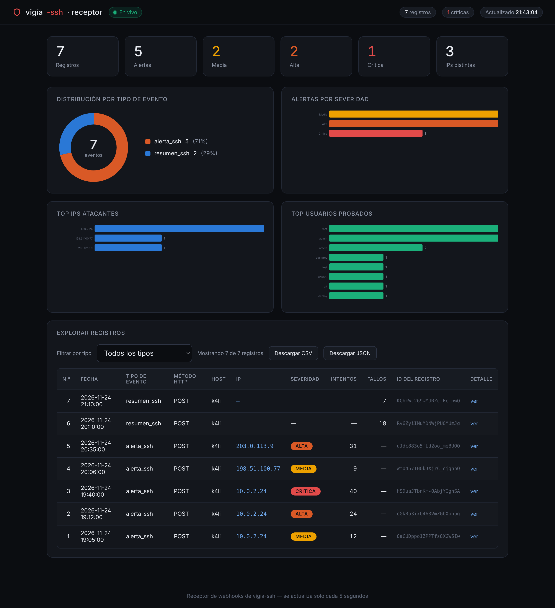

# Dashboard de vigia-ssh

Panel web en vivo para las alertas de `vigia_ssh.py`. Recibe los webhooks que manda el detector,
los guarda y los muestra en un dashboard que se actualiza solo.



Un solo fichero (`receptor.py`), **solo librería estándar de Python** (sin Flask ni nada que
instalar). Sirve:

- Tarjetas de resumen: registros, alertas, media/alta/crítica, IPs distintas.
- Donut de distribución por tipo de evento (`alerta_ssh`, `resumen_ssh`).
- Barras de alertas por severidad, top de IPs atacantes y top de usuarios probados.
- Tabla *Explorar registros* con filtro por tipo, descarga a CSV/JSON y el JSON íntegro de cada
  evento desplegable.

## Cómo lanzarlo

1. Arranca el receptor (donde quieras recibir las alertas):

   ```bash
   python3 receptor.py            # escucha SOLO en http://127.0.0.1:8000/ (local)
   python3 receptor.py -p 9000    # otro puerto
   python3 receptor.py --store registros.jsonl   # otro fichero de almacenamiento
   ```

2. Apunta el canal de vigia a ese receptor y reinicia el servicio:

   ```bash
   sudo sed -i 's#^CANAL=.*#CANAL=http://127.0.0.1:8000/#' /etc/vigia/vigia.conf
   sudo systemctl restart vigia-ssh
   ```

3. Abre el dashboard en el navegador: **http://localhost:8000/**

Lanza un ataque de prueba (ver [../docs/LABORATORIO.md](../docs/LABORATORIO.md)) y las alertas
aparecen solas en la tabla; la página se refresca cada 5 segundos.

## Detalles

- Los registros se guardan en `receptor_registros.jsonl` (o lo que indiques con `--store`), así que
  el historial sobrevive a reinicios del receptor.
- Cada POST recibido se responde con `{"ok": true}`.
- Endpoints: `/` (dashboard HTML), `/datos.json` y `/datos.csv` (los registros en crudo).
- Si vigia y el receptor están en la misma máquina, `CANAL=http://127.0.0.1:8000/` basta y no hace
  falta nada más.

## Seguridad y exposición

El receptor **escucha solo en `127.0.0.1` por defecto**, así que no es accesible desde la red; es la
opción segura para uso local. No lo abras a todas las interfaces sin protegerlo.

Para verlo desde **otro equipo o por internet**:

```bash
# al exponerlo en red el token es OBLIGATORIO: sin él, el receptor no arranca
python3 receptor.py --host 0.0.0.0 --token "$(head -c18 /dev/urandom | base64)"
```

- Con `--token` (o la variable `VIGIA_RECEPTOR_TOKEN`), toda petición sin el token correcto recibe
  `401`. **Se prefiere la cabecera `X-Token`**; `?token=...` también vale para abrirlo en el
  navegador, pero el secreto puede quedar en el historial o en logs de intermediarios.
- `vigia` manda el token en el `POST`; ponlo en `CANAL` (`CANAL=http://IP:8000/?token=...`).
- Mejor aún que `--host 0.0.0.0`: deja el receptor en `127.0.0.1` y publícalo con un túnel con
  HTTPS (`ngrok http 8000`), usando igualmente `--token`.

### Límites

- El cuerpo de cada `POST` se limita a **64 KiB** (un cliente malicioso no puede enviar un cuerpo
  enorme y agotar memoria); por encima recibe `413`.
- El histórico está acotado a **`VIGIA_RECEPTOR_MAX`** registros (10000 por defecto), tanto en
  memoria como en el fichero: al llegar al tope, cae el más antiguo. Para conservar todo, sube el
  valor o apunta `--store` a un volumen con rotación.

## Nota de diseño

El dashboard nunca muestra contraseñas: `sshd` no las registra, así que la alerta de acceso
conseguido (`critica`) no las lleva. La captura de credenciales se hace de forma controlada solo en
el honeypot, cuyo log es `600` (solo root) y conviene **rotar y purgar** periódicamente y **no sacar
de la máquina**: puede contener contraseñas reales de alguien que se equivocó de puerto. Son
decisiones a propósito, no limitaciones.
